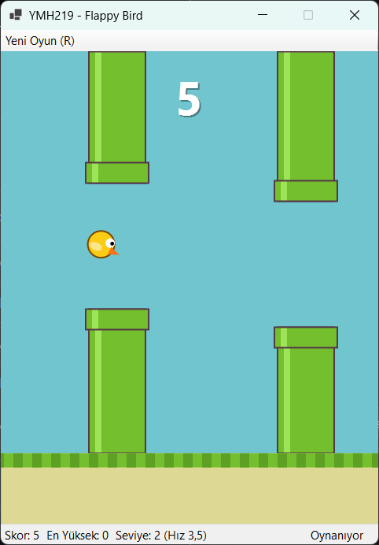
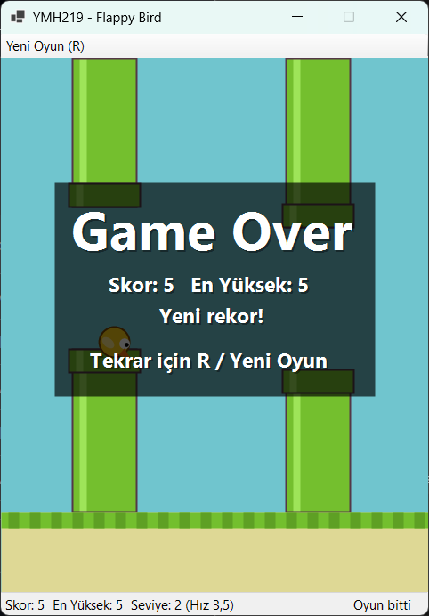

# YMH219 - Flappy Bird

Nesne Tabanlı Programlama (YMH 219) dersi için Windows Forms ile geliştirilen Flappy Bird benzeri masaüstü oyunu. Kuş klavyeyle zıplar, yer çekimiyle düşer ve sağdan sola akan boruların arasından geçmeye çalışır. Oyun döngüsü bir `Timer` ile çalışır; oyuncu, engeller ve oyun durumu ayrı sınıflarla yönetilir.

## Kullanılan Teknolojiler

- C# / .NET 9 (`net9.0-windows`)
- Windows Forms (`Form`, `Panel`, `Timer`, `ToolStrip`, `StatusStrip`, `MessageBox`)
- GDI+ (`System.Drawing`) ile çizim; harici görsel veya NuGet paketi kullanılmaz
- Dosya işlemleri (`File`, `Directory`) ile en yüksek skor kaydı

## Kurulum ve Çalıştırma

1. Windows üzerinde [.NET 9 SDK](https://dotnet.microsoft.com/download) kurulu olmalıdır.
2. Depoyu klonlayın:
   ```bash
   git clone https://github.com/<kullanici-adi>/YMH219-FlappyBird.git
   cd YMH219-FlappyBird
   ```
3. Uygulamayı çalıştırın:
   ```bash
   dotnet run --project YMH219-FlappyBird
   ```
   Alternatif olarak `YMH219-FlappyBird.sln` dosyasını Visual Studio 2022 ile açıp **F5** ile başlatabilirsiniz.

## Kontroller

| Tuş | İşlev |
| --- | --- |
| Space / Yukarı Ok | Oyunu başlat, zıpla |
| R | Yeni oyun |
| "Yeni Oyun (R)" düğmesi | Yeni oyun |

## Temel Özellikler

- Yer çekimi ve zıplama fiziği (`Bird` sınıfı)
- Ekranda sağdan sola hareket eden, ekrandan çıkınca rastgele boşlukla yeniden konumlanan borular (`Pipe` sınıfı)
- Boru veya zemine çarpınca oyunun durması ve "Game Over" ekranı
- Geçilen her boru için skor artışı
- Her 5 puanda seviye atlama ve hız artışı (en fazla 5,0)
- En yüksek skorun `%LOCALAPPDATA%\YMH219-FlappyBird\highscore.txt` dosyasında saklanması; kaydedilemezse kullanıcıya uyarı
- Durum çubuğunda skor, en yüksek skor, seviye, hız ve oyun durumu

## Sınıf Yapısı

| Sınıf | Görev |
| --- | --- |
| `MainForm` | Pencere, `Timer` oyun döngüsü, klavye olayları, durum çubuğu |
| `GamePanel` | Çift tamponlu panel; oyun alanını çizer |
| `GameSession` | Oyun durumu (`Ready`, `Playing`, `GameOver`), skor, hız, çarpışma |
| `Bird` | Kuşun konumu, hızı, yer çekimi ve zıplaması |
| `Pipe` | Borunun konumu, boşluğu ve çarpışma alanları |
| `HighScoreStore` | En yüksek skoru dosyadan okur ve dosyaya yazar |

## Ekran Görüntüleri

<!-- Ekran görüntülerini docs/screenshots klasörüne aşağıdaki adlarla ekleyin. -->

| Oyun ekranı | Oyun sonu |
| --- | --- |
|  |  |

## Bilinen Sınırlamalar / Geliştirme Notları

- Yalnızca Windows'ta çalışır (Windows Forms).
- Kare hızı `Timer` aralığına bağlıdır; yoğun sistemlerde oyun hafifçe yavaşlayabilir.
- Ses efekti yoktur.

## Öğrenci

- Ad Soyad: Kübra Demirgüç
- Öğrenci No: 230541115
